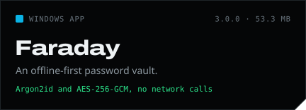
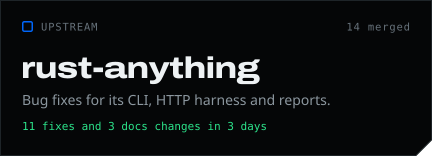
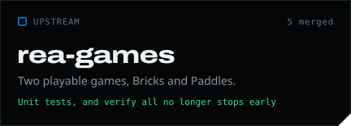
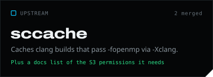
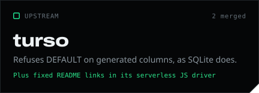

<b>UPSTREAM</b> · <a href="https://github.com/search?q=is%3Apr+is%3Amerged+author%3Apuretechteam+-user%3Apuretechteam&amp;type=pullrequests">26 merged in 7 projects</a>

[Website](https://puretechteam.github.io) · [X](https://x.com/puretechteam) · [Discord](https://discord.gg/dRMRGCG9Fk)
